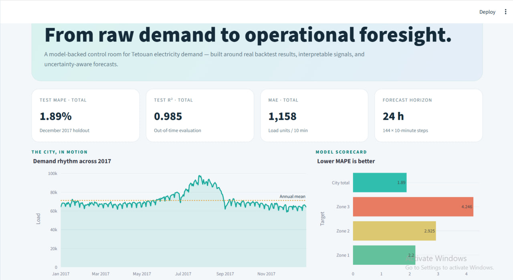
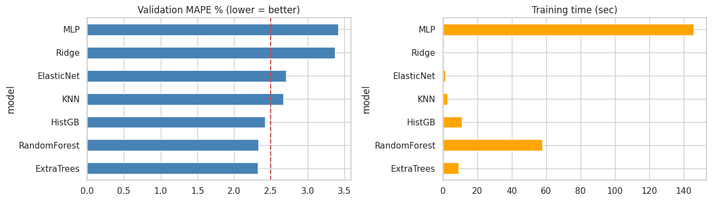
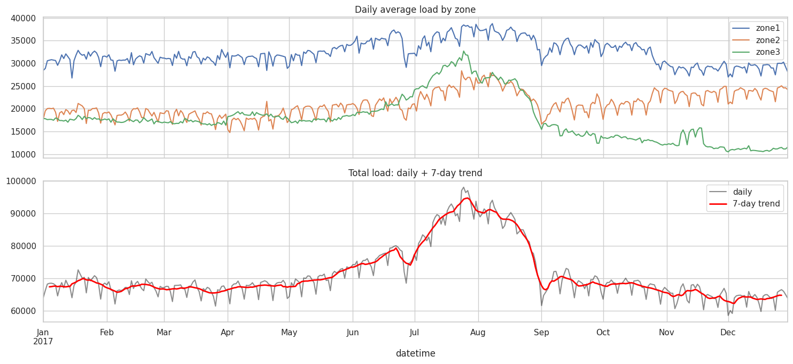

# WATT: Electricity Load Forecasting

**Day-ahead electricity demand forecasting for Tetouan, Morocco, with a reproducible machine-learning workflow and an interactive Streamlit application.**

WATT turns time-stamped electricity and weather observations into short-term demand forecasts for three distribution zones and the city-wide total. The project combines chronological model evaluation, lag-based and calendar-aware feature engineering, model selection, saved inference pipelines, and an interactive application designed to make results easier to inspect and communicate.

> **Evaluation boundary:** The supplied source dataset covers 2017. The reported scores below are from a December 2017 chronological holdout. They are historical evaluation results, not a guarantee of future performance and not live telemetry.




## Project at a glance

| Item | Description |
|---|---|
| Problem type | Supervised time-series regression |
| Use case | Day-ahead electricity load forecasting |
| Geographic scope | Tetouan, Morocco |
| Source period | January–December 2017 |
| Sampling frequency | One observation every 10 minutes |
| Source observations | 52,416 time steps |
| Forecast horizon | 24 hours, represented by 144 ten-minute steps |
| Forecast targets | `zone1`, `zone2`, `zone3`, and `total` |
| Explanatory inputs | Weather, time/calendar signals, and historical load features |
| Validation principle | Chronological splits; future observations must not leak into training |
| Application | Streamlit, with English/Arabic interface options |

## Results on the December 2017 holdout

The final model bundle was selected using validation results and then evaluated on a later chronological test period. The reported total-load MAPE is **1.89%**. Zone-level performance differs, which is why evaluation is reported separately for each target.

| Target | Selected model | MAPE | MAE | RMSE | R² |
|---|---|---:|---:|---:|---:|
| City total | ExtraTrees | 1.89% | 1,158.17 | 1,772.33 | 0.985 |
| Zone 1 | HistGradientBoosting + ExtraTrees + Ridge | 2.20% | 618.17 | 885.86 | 0.980 |
| Zone 2 | HistGradientBoosting + ExtraTrees | 2.93% | 654.54 | 1,006.81 | 0.970 |
| Zone 3 | ExtraTrees | 4.25% | 446.78 | 608.33 | 0.950 |

Metric definitions:

- **MAE** is the mean absolute difference between actual and predicted load, expressed in the dataset's load units.
- **RMSE** penalizes larger errors more strongly than MAE.
- **MAPE** reports the average absolute percentage error.
- **R²** describes the proportion of target variance explained by the predictions on the evaluated sample.

The total-load model's holdout MAE was approximately 36.4% lower than the best naive baseline MAE reported by the notebook. Zone 3 is a known weak point: its MAPE is higher than the strongest naive comparator on this test period. Model quality should therefore not be summarized by a single aggregate score alone.



## Data and forecasting context

The source file contains electricity consumption for three zones in Tetouan together with meteorological variables. The target `total` is the sum of the three zone loads when derived by the project pipeline.

The model workflow uses information that would be available at forecast time, including:

- Recent historical demand and lagged load values.
- Calendar features derived from timestamps.
- Weather observations or forecast values, including temperature, humidity, wind, and solar-radiation measures.
- Reference-profile features used to represent recent or recurring demand patterns.

The supplied data is a single year. That is sufficient to build and evaluate a baseline forecasting workflow, but it limits the evidence available for unusual seasons, changing customer behavior, long-term trends, and rare events.




## Methodology

### 1. Problem definition

The task is framed as supervised time-series regression: use information available at a given forecast origin to estimate electricity demand for the next 24 hours. The target is evaluated independently for each zone and for the combined city total.

### 2. Data quality and exploratory analysis

The workflow inspects timestamp coverage, sampling regularity, target distributions, zone-level differences, demand seasonality, and relationships between weather and electricity use. Exploratory analysis is used to guide feature design and error investigation rather than to make causal claims.

### 3. Chronological validation

Random shuffling is inappropriate for this forecasting problem because it can allow later time periods to influence model selection for earlier periods. The notebook uses time-ordered training, validation, and test periods. The final December 2017 holdout is reserved for reporting the final evaluation.

### 4. Feature engineering

The feature set combines:

- Lagged demand values and recurring time-slot reference profiles.
- Hour, day-of-week, and other calendar signals.
- Weather variables aligned to the forecast timestamps.
- Reference-based strategies where appropriate for individual targets.

All feature values used for a prediction must be available at the forecast origin. For a real deployment, weather inputs for future timestamps must come from an actual weather forecast provider or another verified source.

### 5. Model comparison and selection

The notebook compares simple persistence-style baselines with machine-learning regressors and candidate ensembles. The final target-specific selections recorded in the project metadata are:

- `zone1`: HistGradientBoosting, ExtraTrees, and Ridge blend.
- `zone2`: HistGradientBoosting and ExtraTrees blend.
- `zone3`: ExtraTrees.
- `total`: ExtraTrees.

This target-specific design reflects the fact that different zones have different demand patterns and error behavior. The selected model is not assumed to be equally reliable for every target or operating condition.

### 6. Error analysis

The notebook examines performance by target and by time-related segments, including hours, day types, and unusual dates. Holiday effects and changes in Zone 3 demand are important limitations identified during the analysis. Such findings are used to guide monitoring and future data improvements.

### 7. Deployment and inference

The Streamlit application loads the saved production model bundle and the matching feature/inference code. The application distinguishes historical replay from a new forecast: the 2017 data is provided for inspection and demonstration, while a real forward forecast requires recent history and future weather inputs.

## Application capabilities

The Streamlit interface is organized into pages intended for different stages of forecast review:

| Page | Purpose |
|---|---|
| Command Center | High-level demand trends, key evaluation metrics, and project signals |
| Prediction Studio | Generate a new 24-hour forecast from uploaded recent history and future weather |
| Forecast Lab | Inspect model forecasts and historical replay behavior |
| Model Observatory | Compare target-specific model performance |
| Anomaly Radar | Explore unusual demand behavior |
| Scenario Studio | Explore weather sensitivity and what-if assumptions |
| AI Analyst | Ask questions about available project context when Gemini is configured |
| Export Center | Prepare downloadable outputs and reports |

The AI Analyst requires a Gemini API key and an installed compatible client library. The rest of the forecasting workflow should be usable without exposing credentials in source code.

## Run locally

### Requirements

- Python 3.10 or a compatible version supported by the installed dependencies.
- The project files listed below.
- A terminal with access to install Python packages.
- A Gemini API key only if the AI Analyst feature is needed.

### 1. Extract and open the project

Extract the deployment ZIP and open the `WATT_Electricity_Forecasting_Streamlit` folder in Visual Studio Code.

### 2. Create a virtual environment

**Windows PowerShell**

```powershell
py -m venv .venv
.venv\Scripts\Activate.ps1
```

**macOS / Linux**

```bash
python3 -m venv .venv
source .venv/bin/activate
```

### 3. Install dependencies

```bash
python -m pip install --upgrade pip
pip install -r requirements.txt
```

### 4. Start the application

```bash
streamlit run app.py
```

Streamlit will print a local URL in the terminal, commonly `http://localhost:8501`.

## Generate a future forecast

The Prediction Studio expects two CSV files.

### Input A: recent load history

Upload a CSV containing a `datetime` column and these columns:

```text
datetime, temp, humidity, wind, gen_diffuse, diffuse, zone1, zone2, zone3
```

The app can derive `total` from the three zone columns when it is missing. The history should contain at least approximately nine days of continuous observations at ten-minute intervals, with the load values and weather features needed by the saved pipeline.

### Input B: future weather forecast

Upload a CSV containing exactly one row for each target timestamp and the following fields:

```text
datetime, temp, humidity, wind, gen_diffuse, diffuse
```

The timestamps must align with the 144 future ten-minute forecast steps. These weather values must represent the intended forecast period. Historical weather copied forward or made-up values can be used only for a technical demonstration and must not be presented as a real weather forecast.

### Output

The Prediction Studio is designed to produce 144 future predictions covering 24 hours, with results that can be reviewed in the application and downloaded when the export control is available.

**Demo-data warning:** The included `history_2017.csv` represents historical data from 2017. Any synthetic sample CSV files supplied for testing are fabricated test inputs. They are useful for checking the upload and inference flow, but their predictions are not valid operational forecasts.

## AI Analyst configuration

Create a local file at `.streamlit/secrets.toml`:

```toml
GEMINI_API_KEY = "YOUR_GEMINI_API_KEY"
GEMINI_MODEL = "gemini-2.5-flash"
```

Use your own valid key. Do not commit `.streamlit/secrets.toml` to version control, publish it in screenshots, or place the key directly in `app.py`. For a hosted Streamlit deployment, configure these values through the platform's secrets settings.

If the AI Analyst is not needed, leave the key unset. If an API key has ever been exposed publicly or pasted into a shared conversation, revoke it and create a replacement before deployment.

## Repository structure

Keep the following paths and filenames unchanged unless you also update the corresponding imports and path references.

```text
WATT_Electricity_Forecasting_Streamlit/
├── app.py
├── inference.py
├── feature_pipeline.py
├── model_production.pkl
├── model_backtest.pkl
├── metadata.json
├── config.json
├── history_2017.csv
├── MODEL_CARD.md
├── requirements.txt
├── .streamlit/
│   └── secrets.toml.example
├── assets/
│   └── images/
│       ├── load_profile_2017.png
│       ├── zone_load_comparison.png
│       └── model_performance_mape.png
└── README.md
```

The figures are generated from the supplied 2017 dataset and the notebook's saved evaluation results. They are explanatory plots, not screenshots of a running application.

## Reproducibility and model artifacts

- `app.py` defines the Streamlit user interface.
- `feature_pipeline.py` contains feature construction used by the model workflow.
- `inference.py` loads the bundle and runs forecasting.
- `model_production.pkl` is the saved production model bundle.
- `model_backtest.pkl` is the backtest bundle trained according to the documented temporal split.
- `metadata.json` stores model choices and evaluation metrics.
- `config.json` stores configuration used by the project.
- `history_2017.csv` is the supplied historical dataset for the application.

Python pickle-based model files should only be loaded from trusted sources. They are executable serialization artifacts and should not be accepted from unknown users.

## Limitations and responsible use

1. **Limited historical coverage.** One year of data cannot fully represent long-term changes, all seasonal regimes, or rare events.
2. **Holiday sensitivity.** Unusual holidays can produce errors much larger than the overall average.
3. **Zone 3 regime changes.** The third zone is the least reliable of the three zone-level targets in the reported holdout comparison.
4. **Weather forecast dependency.** A real forward forecast requires weather values for future timestamps. Incorrect weather inputs can degrade results.
5. **Metric scope.** December 2017 metrics describe one chronological holdout and do not guarantee performance in other months, years, or locations.
6. **No live telemetry by default.** The supplied application and data do not establish a live connection to a utility or real-time meter stream.
7. **Prediction intervals.** Where displayed, interval bands are empirical error bands derived from historical evaluation; they are not guaranteed confidence intervals.
8. **Operational use.** Treat the project as a forecasting prototype and decision-support tool. Validate against recent local data, establish monitoring, and review performance before using forecasts for operational decisions.

## Recommended next steps

- Validate the model on additional years and rolling-origin evaluation windows.
- Improve the holiday calendar and encode special-day effects explicitly.
- Investigate the Zone 3 regime shift and obtain contextual operational data if available.
- Monitor error by zone, hour, season, and day type after deployment.
- Track data freshness, missing timestamps, input drift, and forecast error.
- Retrain only through a documented evaluation process and retain a reproducible record of each model version.
- For production operation, connect a verified weather forecast feed and a trusted recent-load source.

## Credits and project scope

This project is based on the Tetouan City electricity consumption and weather dataset covering 2017. The notebook documents the end-to-end machine-learning workflow, while the Streamlit application packages the saved inference pipeline into an interactive interface.

The project demonstrates a complete forecasting workflow, from problem framing and exploratory analysis through feature engineering, chronological model evaluation, error analysis, model packaging, and interactive deployment. The reported metrics are included to make the project assessable and transparent; the limitations are included to distinguish a promising prototype from a fully validated operational forecasting service.
